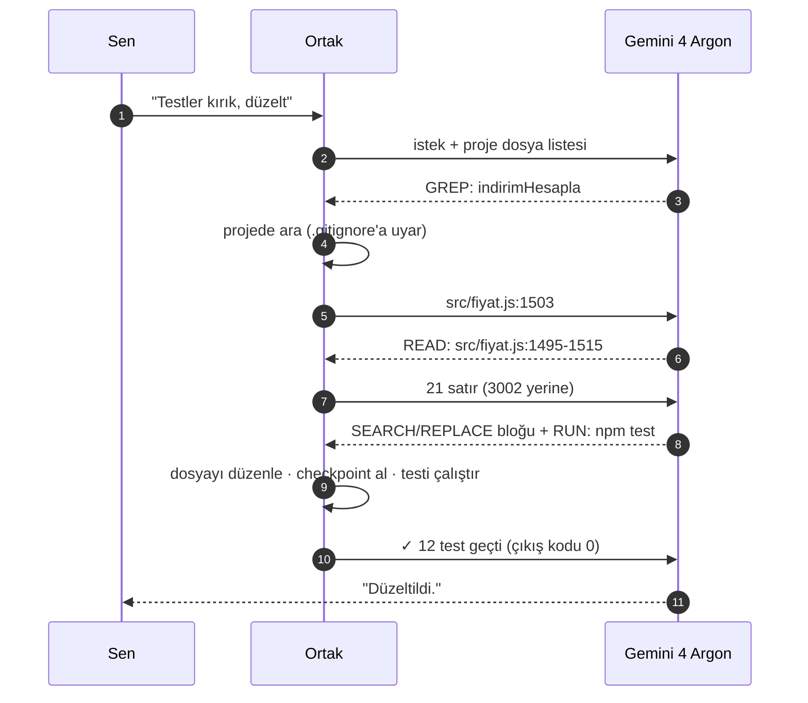
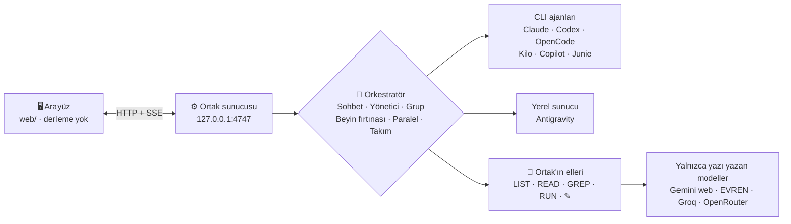

<div align="center">



<p>


</p>

**Claude Code · Codex · Gemini · Antigravity · Copilot · OpenCode · Kilo · Junie · EVREN · Groq · OpenRouter**<br>
Hepsi zaten bilgisayarında. Ortak onları **aynı masaya oturtur**: konuşturur, tartıştırır, işi bölüştürür.

</div>

---

## ▶ Bölümler

> Bu README bir videonun bölümleri gibi ilerliyor. Sahneler kendiliğinden oynar ve başa sarar; ▸ işaretli satırlara tıklayınca perde arkası açılır.

| | Bölüm | Bu bölümde |
|:-:|---|---|
| 🎬 | [**1. Eli olmayan modele eller**](#-bölüm-1--eli-olmayan-modele-eller) | Gemini 4 Argon'un dosyası, terminali yok. Ortak onun elleri olur. |
| 🧭 | [**2. Yönetici ve ekibi**](#-bölüm-2--yönetici-ve-ekibi) | Opus işi böler, üç ajan paralel çalışır. |
| 💬 | [**3. Tartışan yapay zekâlar**](#-bölüm-3--tartışan-yapay-zekâlar) | Ajanlar `@` ile birbirine laf atar, uzlaşır. |
| ⚡ | [**4. Aynı iş, üç çözüm**](#-bölüm-4--aynı-iş-üç-çözüm) | Üç ajan yarışır, beğendiğini tek tıkla alırsın. |
| 👥 | [**5. Planla, uygula, denetle**](#-bölüm-5--planla-uygula-denetle) | Codex planlar, altı çalışan sırayla uygular, Argon denetler. |
| 🧩 | [**Hangi mod bana göre?**](#-hangi-mod-bana-göre) | Üç soruluk mini test. |
| 🚀 | [**60 saniyede kurulum**](#-60-saniyede-kurulum) | `npm start` ve hepsi bu. |

---

## 🎬 Bölüm 1 — Eli olmayan modele eller



Gemini web'deki **4 Argon** ya da **EVREN**, **Groq**, **OpenRouter** gibi API modelleri yalnızca yazı yazabilir; dosya açamaz, komut çalıştıramaz.
Ortak bu modellerin cevabında birkaç basit komut arar ve hepsini **kendisi yapar**:

```text
LIST: src/                 klasörde gez
FIND: *.test.js            adına göre dosya bul
OUTLINE: src/fiyat.js      fonksiyon ve sınıfları satır numaralarıyla gör
SYMBOL: indirimHesapla     tanımın yerini bul
READ: src/fiyat.js:1495-1515   sadece o satırları oku
GREP: indirimHesapla       tüm projede ara
GIT: diff                  kendi değişikliklerini gözden geçir
RUN:  npm test             terminalde çalıştır (PowerShell / sh)
WEB: node fetch timeout    internette ara  ·  FETCH: https://…  sayfayı oku
DELETE: eski.js  ·  MOVE: a.js -> lib/a.js   dosya sil / taşı (geri alınabilir)
```

Modelin verdiği değişiklik blokları dosyaya uygulanır ve sonucu modele geri gönderilir. Model de Codex gibi çalışır: okur, düzeltir, test eder, tekrar dener.

- **Girintiyi yanlış yazsa da uygulanır.** Ücretsiz modeller boşlukları sık bozar; Ortak metni girinti farkını yok sayarak bulur ve yeni satırları dosyanın girintisine oturtur. Bulamazsa dosyadaki en yakın yeri gösterir.
- **Bozduysa hemen duyar.** Her düzenlemeden sonra dosya sözdizimi kontrolünden geçer (JavaScript, JSON, Python); hata varsa model aynı turda düzeltir.
- **Projenin kurallarını bilir.** `AGENTS.md`, `CLAUDE.md`, `GEMINI.md`, `.cursorrules` gibi talimat dosyaları ilk mesajda modele verilir; büyük projelerde 400 dosyalık liste yerine klasör haritası gider.
- **Bağlamı taşmaz.** Araç çıktıları modelin kaldırabileceği kadar kısaltılır (Groq'un ücretsiz katmanına küçük, Gemini'ye büyük); konuşma uzayınca eski çıktılar özetlenir.

> 🛠️ **Gerçek araç çağırma.** Groq, OpenRouter ve EVREN'deki modellerin çoğu *function calling* destekler; Cline ya da Kilo gibi araçlar DeepSeek'i de bu yöntemle kullanır. Bu modellere Ortak aynı elleri gerçek araçlar olarak verir: `list_dir`, `find_files`, `read_file`, `outline`, `find_symbol`, `grep`, `git`, `run_command`, `web_search`, `web_fetch`, `edit_file`, `multi_edit`, `replace_lines`, `write_file`, `delete_file`, `move_file`. Araç desteklemeyen bir model seçilirse Ortak bunu kendisi fark eder ve yukarıdaki yazı komutlarına geçer.

<details>
<summary><b>▸ Perde arkası: bir tur nasıl dönüyor?</b></summary>

<br>



- **Geri al:** Her turun değişiklikleri sohbette `N dosya değişti — Geri al` çubuğu olarak görünür. Sonradan senin değiştirdiğin bir dosyanın üzerine yazmaz.
- **Yetki:** *Salt okunur* yetkide yalnızca hiçbir şeyi değiştirmeyen komutlar çalışır. *Düzenleme* yetkisinde `git push`, global kurulum, toplu silme gibi tehlikeli komutlar engellenir. *Tam yetki*de sınır yoktur.
- **Resim:** Mesaja eklediğin ekran görüntüsünü Gemini'ye yapıştırır. EVREN'de resim görebilen modellere gönderir.

</details>

---

## 🧭 Bölüm 2 — Yönetici ve ekibi



Yönetici model **kod yazmaz**. Projeyi okur, işi parçalara böler, her parçayı en uygun ajana verir, diff'leri denetler, eksik varsa geri gönderir.
Birbirinden bağımsız işler **aynı anda** başlar. Bir işe bağlı olan iş (`after`) o iş biter bitmez başlar.

**Limitini koru.** Ekip varsayılan olarak **otomatik** kurulur: Ortak bilgisayarındaki aktif ajanlara ve API'lere bakar, her modelin **ücretsiz**, **abonelik** ya da **ücretli** olduğunu bilir. "Ücretsiz öncelikli" bütçede işi Groq, OpenRouter, Gemini gibi ücretsiz modeller yapar; Claude / ChatGPT yalnızca planlar ve denetler. EVREN'in kredili modelleri ücretsizlerden sonra, GitHub Copilot'un plana dahil (×0) modelleri ücretsiz sayılır. Claude Code ve Codex otomatik çalışan olarak eklenmez; yalnızca açıkça yönetici veya çalışan seçtiğinde kullanılır. Eski çalışmalardaki çalışan kayıtları izin sayılmaz. Ücretsiz bir modelin limiti dolarsa görevi Ortak kendiliğinden başka bir izinli modele devreder. Sonuçta hangi işin hangi sınıfta yapıldığı ve yöneticinin kaç tur düşündüğü yazılır.

**Bütün modelleri bilir, aynı anda çalıştırır.** Yönetici her sağlayıcının altındaki bütün modelleri (OpenRouter'ın ücretsiz modelleri, EVREN'in GLM / DeepSeek modelleri, Copilot, Groq…) `sağlayıcı:model` adlarıyla görür ve **her görev için modeli kendisi seçer**. Aynı anda varsayılan olarak **5 görev** çalışır (Gelişmiş → *Aynı anda görev*). Aynı modele birden çok görev verirse Ortak o modelin yeni bir kopyasını açar; aynı modeli iki farklı sağlayıcıdan da çalıştırabilir.

<details>
<summary><b>▸ Limit dolarsa ne olur?</b></summary>

<br>

Çalışma hata vermez, **durur**. Yapılanlar, yarım kalan işler ve yöneticinin oturumu kaydedilir. Limit yenilenince `devam et` yazman yeterli.
Sunucu yoğunluğu, bağlantı kopması gibi geçici hatalar 20 sn ve 60 sn sonra kendiliğinden yeniden denenir.

</details>

---

## 💬 Bölüm 3 — Tartışan yapay zekâlar



**Grup sohbeti**nde modeller tek bir sohbette sırayla konuşur. Birbirine `@codex` diye hitap eder, soru sorar, itiraz eder.
Herkes `[UZLAŞI]` deyince ya da tur sınırına gelince durur. Sen istediğin an araya girebilirsin.

**Beyin fırtınası** daha düzenlidir: Önce herkes bağımsız cevap verir, sonra birbirinin cevabını eleştirir. Sonunda moderatör özetler.

---

## ⚡ Bölüm 4 — Aynı iş, üç çözüm



**Paralel** modda aynı görevi birden çok ajan, her biri kendi `git worktree`'sinde aynı anda yapar. Projen bu sırada değişmez.
Diff'leri yan yana karşılaştırırsın, beğendiğini **Bunu uygula** ile alırsın.

---

## 👥 Bölüm 5 — Planla, uygula, denetle



**Takım** modu bir iş akışıdır. Üç rol var:
- **Planlayıcı** görevi adımlara böler.
- **Çalışanlar** adımları sırayla, dönüşümlü olarak uygular.
- **Denetçi** sonucu inceler. Eksik görürse **düzeltme turu** ister ve düzeltmeyi yeniden kontrol eder; bu döngü onay verene kadar en fazla 3 tur sürer (ayarlanabilir).

Denetçi değişikliklerin hepsini görür: diff dosya dosya hazırlanır, resim ve kilit dosyaları tek satırla özetlenir, sığmayan dosyalar adıyla bildirilir ve denetçi onları kendisi okur. Limit dolar ya da bağlantı koparsa takım **durur, kaybetmez**: yapılan her adım kaydedilir, `devam et` yazınca kaldığı yerden sürer.

Her role istediğin ajanı ve modeli koyabilirsin; ücretli ve ücretsiz modeller karışık olabilir. Kendi aracı olmayan modeller (Groq, EVREN, OpenRouter, Gemini web) çalışan olarak da iş görür, çünkü dosya ve terminal işlerini onların yerine Ortak yapar.

<details>
<summary><b>▸ Takım mı, Yönetici mi?</b></summary>

<br>

| | Takım | Yönetici |
|---|---|---|
| Plan | Bir kez yapılır, sabit kalır | Yönetici iş sürerken planı değiştirebilir |
| Sıra | Adımlar **sırayla** uygulanır | Bağımsız işler **paralel**, bağımlı olanlar arkadan |
| Denetim | Sonda denetçi + onaya kadar düzeltme turları | Yönetici her raporu ayrı ayrı denetler |
| En uygun iş | Adımları belli, düz ilerleyen işler | Büyük, dallı budaklı işler |

</details>

---

## 🧩 Hangi mod bana göre?

<details>
<summary><b>▸ Bir soru sormak ya da fikir almak istiyorum</b></summary>
<blockquote>
<details><summary>Tek bir modelin cevabı yeter</summary><blockquote>→ <b>Sohbet · Tek model.</b> claude.ai gibi; proje klasörü bile gerekmez.</blockquote></details>
<details><summary>Farklı görüşler görmek istiyorum</summary><blockquote>
<details><summary>Serbestçe tartışsınlar</summary><blockquote>→ <b>Grup sohbeti.</b> Birbirlerine <code>@</code> ile hitap edip uzlaşana kadar konuşurlar.</blockquote></details>
<details><summary>Düzenli tur ve özet istiyorum</summary><blockquote>→ <b>Beyin fırtınası.</b> Bağımsız cevap → çapraz eleştiri → moderatör özeti.</blockquote></details>
</blockquote></details>
</blockquote>
</details>

<details>
<summary><b>▸ Projemde kod yazdırmak istiyorum</b></summary>
<blockquote>
<details><summary>Küçük, net bir iş</summary><blockquote>→ <b>Kod · Sohbet.</b> Tek ajan, Claude Code gibi çalışır. Gemini 4 Argon bile seçilebilir.</blockquote></details>
<details><summary>Büyük, parçalı bir iş</summary><blockquote>→ <b>Yönetici.</b> Opus böler ve dağıtır, ekip paralel çalışır.</blockquote></details>
<details><summary>Plan → uygulama → inceleme sırası istiyorum</summary><blockquote>→ <b>Takım.</b> Örneğin Claude planlar, Codex yazar, Antigravity inceler.</blockquote></details>
<details><summary>En iyi çözümü seçmek istiyorum</summary><blockquote>→ <b>Paralel.</b> Üç ajan yarışır, kazananı sen seçersin.</blockquote></details>
</blockquote>
</details>

---

## 🤝 Masadaki ajanlar

Her ajan **kendi aboneliğinle, kendi limitinle** çalışır; Ortak yalnızca onları yönetir. Kalan limitlerini sol paneldeki **Ajanlar** bölümünde canlı görürsün.

| | Ajan | Bağlantı | Not |
|:-:|---|---|---|
| 🟠 | **Claude Code** | `claude -p` | Opus, Sonnet, Haiku, Fable |
| 🟢 | **OpenAI Codex** | `codex exec` | ChatGPT hesabınla |
| 🟣 | **Antigravity** | uygulamanın yerel sunucusu | Gemini, Claude, GPT-OSS |
| 🔵 | **Gemini (web)** | Ortak'ın kendi Chrome penceresi | 4 Argon, 3.1 Pro, Flash · *Ortak'ın elleriyle* |
| 🟡 | **OpenCode** | `opencode run` | Hesapsız **ücretsiz** modeller |
| 🟠 | **Kilo Code** | `kilo run` | 300+ model, ücretsizleri hesapsız |
| ⚪ | **GitHub Copilot** | `copilot` CLI | Copilot Free ile de çalışır |
| 🟢 | **Junie** | `junie` | Junie Lite ücretsiz |
| 🔴 | **EVREN** | OpenAI uyumlu API | Kendi API anahtarınla · *Ortak'ın elleriyle* |
| 🟥 | **Groq** | LPU üzerinde OpenAI uyumlu API | Çok hızlı; ücretsiz planda günde 1.000 istek · *Ortak'ın elleriyle* |
| ⬜ | **OpenRouter** | OpenAI uyumlu API | Yalnızca **ücretsiz** (`:free`) modeller; ücretlileri kullanmaz · *Ortak'ın elleriyle* |

<details>
<summary><b>▸ Mimari: hepsi nasıl bağlanıyor?</b></summary>

<br>



Yeni bir ajan eklemek için `server/adapters/` altına bir adaptör yazmak yeterli. Ayrıntılar [docs/CONTRACT.md](docs/CONTRACT.md) dosyasında.

</details>

---

## 🚀 60 saniyede kurulum

**1.** [Node.js 22+](https://nodejs.org) kur. Başka npm paketi gerekmez.

**2.** Projeyi indirip başlat:

```bash
git clone https://github.com/nowackk-cp/ortak.git
```

```bash
cd ortak && npm start
```

**3.** <http://127.0.0.1:4747> adresini aç. Sol paneldeki **Ajanlar** listesi, bilgisayarında kurulu ve giriş yapılmış olan ajanları kendiliğinden bulur.

<details>
<summary><b>▸ Windows'ta tek tıkla açılsın</b></summary>

<br>

```bash
npm run kisayol
```

Masaüstüne ve Başlat menüsüne **Ortak** kısayolu eklenir. Sunucu pencere açmadan arka planda başlar, arayüz kendi uygulama penceresinde açılır.
Kapatmak için Başlat menüsünden *Ortak'ı Durdur* ya da `npm run durdur` kullan.

</details>

<details>
<summary><b>▸ Hiç ajan harcamadan denemek istiyorum</b></summary>

<br>

```bash
npm run mock
```

Listeye sahte bir **Test Ajanı** eklenir. Arayüzü ve modları kota harcamadan gezebilirsin.

</details>

<details>
<summary><b>▸ Telefondan kullanmak istiyorum</b></summary>

<br>

Sol alttaki **telefon** simgesi → **Telefondan erişim: Açık** → telefonun kamerasıyla QR kodu okut (telefon aynı Wi-Fi'da olmalı).
Açılan sayfayı **Ana ekrana ekle** ile uygulama gibi kullan. Evin dışından kullanmak için iki cihaza da ücretsiz [Tailscale](https://tailscale.com) kur.
Ayrıntılar ve güvenlik duvarı ayarı: [docs/KULLANIM.md → Telefondan kullanma](docs/KULLANIM.md#telefondan-kullanma).

</details>

---

## 🔒 Güvenlik ve gizlilik

- 🏠 Sunucu yalnızca `127.0.0.1`'e bağlanır, başka sitelerden gelen istekleri reddeder.
- 📱 **Telefondan erişim** kapalı gelir. Açarsan ayrı bir port ağa açılır ve her istekte rastgele bir anahtar (QR kod) ister; açıp kapatmak yalnızca bilgisayardan yapılır.
- 🔑 Ortak ajanların giriş bilgilerini okumaz ve hiçbir yere göndermez. Girişleri ajanların kendi akışları yapar.
- 🗂️ API anahtarları, Gemini oturumu ve sohbet geçmişi `data/` klasöründe durur. Bu klasör git'e hiç girmez.
- ⚠️ **Tam yetki** ajanlara onaysız komut çalıştırma izni verir. Yalnızca güvendiğin klasörlerde kullan.
- ⚠️ **Gemini (web)** resmî bir API değildir; Ortak sayfayı bir kullanıcı gibi kullanır. Google sayfayı değiştirirse bozulabilir. Google otomatik kullanımı kurallarında kısıtladığı için yoğun kullanma.

---

<div align="center">

📖 **Bütün ayrıntılar** (yetki tabloları, performans ayarları, bilinen sınırlamalar):
[**docs/KULLANIM.md**](docs/KULLANIM.md)

<sub>Sahneler <code>scripts/make-readme-art.mjs</code> ile üretilir. Değiştirmek için düzenle ve <code>node scripts/make-readme-art.mjs</code> çalıştır.</sub>

</div>
